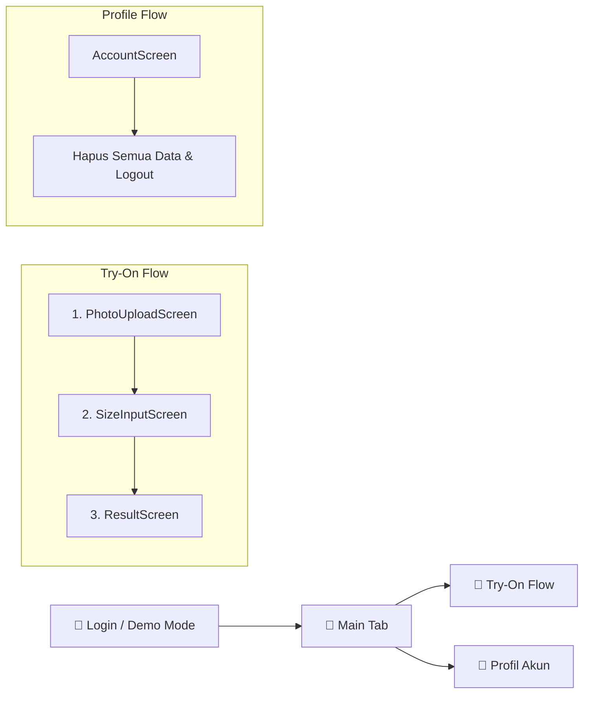

# 👕 FitCheck AI — Virtual Try-On & Size Estimator

<p align="center">
  
</p>

<p align="center">
  <strong>Solusi Cerdas Uji Coba Pakaian Virtual & Estimasi Ukuran Presisi Berbasis AI untuk Kaos dan Atasan.</strong>
</p>

<p align="center">
  
  
  
  
  
</p>

---

## 🌟 Tentang FitCheck AI

**FitCheck AI** hadir untuk mengatasi dilema belanja pakaian online: *"Apakah kaos ini pas di badan saya?"* dan *"Bagaimana tampilannya saat dipakai?"*.

Aplikasi mobile ini menggabungkan dua fitur utama dalam satu alur mulus:
1. **Simulasi AI Virtual Try-On**: Memadukan foto pengguna dengan foto kaos secara visual.
2. **Size & Fit Estimator Matematis**: Menganalisis ukuran tubuh dan pakaian flat-width dengan memperhitungkan elastisitas kain serta peringatan spesifik di area sekunder (bahu & pinggang).

---

## 🚀 Fitur Unggulan

- 📸 **Dual Photo Upload**: Pilih foto tubuh dan foto kaos langsung dari galeri atau gunakan *Sample Data* dengan satu sentuhan.
- 📐 **Smart Fit Estimator**:
  - Menghitung **Chest Ease** otomatis: `(2 × Garment Chest) - Body Chest`.
  - Penyesuaian batas kategori ukuran berdasarkan kelenturan bahan (**Kaku**, **Sedikit Stretch**, **Stretch**).
  - Peringatan dini di area kritis: *"Sempit di bahu"*, *"Jatuh longgar di bahu"*, dan *"Ketat di pinggang"*.
- 🖼️ **Visual Try-On Preview**: Mock visualisasi hasil try-on yang merefleksikan fitting pakaian.
- 🔒 **Keamanan & Privasi Data**:
  - Autentikasi aman melalui Supabase Auth (Email & Password).
  - Row Level Security (RLS) aktif pada semua tabel database.
  - Bucket storage privat terisolasi per folder `user_id`.
  - Fitur **Hapus Semua Data** dengan satu klik untuk membersihkan seluruh data pribadi & gambar.
- ⚡ **Background Processing Ready**: Arsitektur asinkron via Supabase Edge Function (`process-tryon`) yang disiapkan untuk integrasi Google Vertex AI (`virtual-try-on-001`).
- 🎮 **Offline / Demo Mode**: Memungkinkan eksplorasi seluruh UI dan logika kalkulasi tanpa perlu setup database terlebih dahulu.

---

## 🧠 Logika Kalkulasi & Formula Estimator

Logika estimasi diatur di [`src/utils/estimator.ts`](src/utils/estimator.ts) dengan parameter berikut:

### 1. Rumus Utama (Chest Ease)
$$\text{Chest Ease (cm)} = (2 \times \text{garment.chest\_width}) - \text{body.chest}$$

### 2. Kategori Fit Berdasarkan Kelenturan Bahan

| Jenis Bahan | Snug (Ketat) | Regular (Pas Ideal) | Loose (Oversized) |
| :--- | :---: | :---: | :---: |
| **Kaku** | $< 6\text{ cm}$ | $6 \le \text{ease} \le 16\text{ cm}$ | $> 16\text{ cm}$ |
| **Sedikit Stretch** | $< 5\text{ cm}$ | $5 \le \text{ease} \le 16\text{ cm}$ | $> 16\text{ cm}$ |
| **Stretch** | $< 4\text{ cm}$ | $4 \le \text{ease} \le 16\text{ cm}$ | $> 16\text{ cm}$ |

### 3. Peringatan Area Sekunder (Warnings)
- **Bahu Terlalu Sempit**: `garment.shoulder - body.shoulder < -1` $\rightarrow$ *"Sempit di bahu"*
- **Bahu Jatuh Longgar**: `garment.shoulder - body.shoulder > 3` $\rightarrow$ *"Jatuh longgar di bahu"*
- **Pinggang Terlalu Ketat**: `(2 * garment.hem_width) - body.waist < 0` $\rightarrow$ *"Ketat di pinggang"*

---

## 📱 Alur Layar Aplikasi



---

## 🛠️ Tech Stack

- **Mobile Framework**: [React Native](https://reactnative.dev/) dengan [Expo Go](https://expo.dev/) (SDK 58)
- **Bahasa**: [TypeScript](https://www.typescriptlang.org/) (Strict Mode)
- **Navigasi**: [React Navigation](https://reactnavigation.org/) (Native Stack & Bottom Tabs)
- **Image Picker**: [Expo Image Picker](https://docs.expo.dev/versions/latest/sdk/imagepicker/)
- **Backend & Database**: [Supabase](https://supabase.com/)
  - Postgres Database dengan RLS
  - Supabase Auth
  - Supabase Storage (Private Bucket)
  - Supabase Edge Functions (Deno Runtime)
- **AI Target**: Google Vertex AI `virtual-try-on-001` (Boilerplate siap pakai)

---

## 📂 Struktur Direktori

```text
fitcheck-ai/
├── src/
│   ├── context/
│   │   └── AuthContext.tsx        # Manajemen sesi login & Demo Mode
│   ├── lib/
│   │   └── supabase.ts           # Inisialisasi klien Supabase
│   ├── navigation/
│   │   ├── AppNavigator.tsx      # Konfigurasi Stack & Tab navigasi
│   │   └── types.ts              # Definisi TypeScript rute navigasi
│   ├── screens/
│   │   ├── LoginScreen.tsx       # Layar autentikasi & tombol Demo
│   │   ├── PhotoUploadScreen.tsx # Unggah foto tubuh & pakaian
│   │   ├── SizeInputScreen.tsx   # Form ukuran tubuh, pakaian, & kelenturan
│   │   ├── ResultScreen.tsx      # Tampilan label fit, metrics, & hasil try-on
│   │   └── AccountScreen.tsx     # Profil data ukuran & Hapus Semua Data
│   └── utils/
│       └── estimator.ts          # Algoritma perhitungan fit & rules
├── supabase/
│   ├── functions/
│   │   └── process-tryon/        # Edge function background job try-on
│   └── schema.sql                # Skema DDL tabel, RLS, & bucket storage
├── App.tsx                       # Root component
├── .env.example                  # Template variabel lingkungan
└── package.json
```

---

## ⚡ Panduan Instalasi & Menjalankan

### 1. Clone Repositori
```bash
git clone https://github.com/MhmdShofyFuady/FitCheck_AI.git
cd FitCheck_AI
```

### 2. Pasang Dependensi
```bash
npm install
```

### 3. Konfigurasi Environment (Opsional untuk Full Mode)
Salin berkas `.env.example` menjadi `.env`:
```bash
cp .env.example .env
```
Isi nilai URL dan Anon Key dari dashboard Supabase Anda:
```env
EXPO_PUBLIC_SUPABASE_URL=https://your-project-id.supabase.co
EXPO_PUBLIC_SUPABASE_ANON_KEY=your-anon-key
```
> 💡 *Catatan: Jika Anda belum menyiapkan Supabase, Anda dapat langsung menekan tombol **"Masuk Mode Demo"** di layar login untuk mencoba seluruh alur aplikasi secara lokal.*

### 4. Eksekusi Skema Database
Buka **SQL Editor** pada project Supabase Anda, lalu jalankan seluruh isi berkas:
```bash
supabase/schema.sql
```

### 5. Jalankan Aplikasi
```bash
# Memulai bundler Expo
npx expo start
```
- Buka aplikasi **Expo Go** pada perangkat fisik Android/iOS Anda dan pindai QR code yang tampil di terminal.
- Atau tekan `i` untuk iOS Simulator / `a` untuk Android Emulator.

---

## 🧪 Pengujian Unit & Typecheck

Memastikan seluruh tipe dan logika estimator berjalan akurat:

```bash
# Typecheck TypeScript
npx tsc --noEmit

# Validasi assert logika estimator
node --experimental-strip-types -e '
import assert from "node:assert/strict";
import { calculateFit } from "./src/utils/estimator.ts";
assert.equal(calculateFit({ chest: 98 }, { chest_width: 52, stretch_type: "kaku" }).fit_label, "regular");
console.log("Estimator valid!");
'
```

---

## 🗺️ Roadmap Pengembangan

- [x] MVP Core: Upload foto tubuh & pakaian
- [x] Estimator matematis kelonggaran dada & deteksi kelenturan kain
- [x] Integrasi database Supabase (Profiles, Garments, TryOn Jobs, Fit Results)
- [x] Policy Row Level Security (RLS) & Private Storage
- [ ] Implementasi live pipeline Vertex AI (`virtual-try-on-001`) pada Edge Function
- [ ] Fitur riwayat perbandingan fitting berbagai merk kaos
- [ ] Estimasi ukuran untuk celana / bawahan (Bottoms)

---

## 📄 Lisensi

Didistribusikan di bawah lisensi MIT. Lihat `LICENSE` untuk informasi lebih lanjut.

---

<p align="center">
  Dibuat dengan ❤️ untuk pengalaman belanja pakaian yang lebih pas dan percaya diri.
</p>
